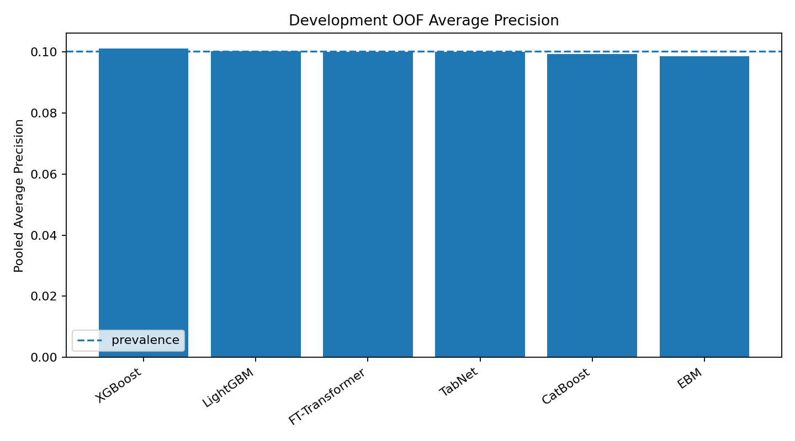

# Employee Resignation Prediction Final Group Report

IT2011 Artificial Intelligence and Machine Learning

**Group ID:** [INSERT OFFICIAL GROUP ID]

**Authors:** [INSERT GROUP MEMBER NAMES]

Prepared for the final group evaluation. This report compares six models, explains their development validation and records the limits of the results. The main finding is that resignation ranking remains near the no-skill baseline. The formal holdout has not been evaluated.

| Member | Model responsibility | Student name | IT number |
|---|---|---|---|
| 1 | FT-Transformer | [INSERT NAME] | [INSERT IT NUMBER] |
| 2 | CatBoost | [INSERT NAME] | [INSERT IT NUMBER] |
| 3 | XGBoost | [INSERT NAME] | [INSERT IT NUMBER] |
| 4 | LightGBM | [INSERT NAME] | [INSERT IT NUMBER] |
| 5 | EBM | [INSERT NAME] | [INSERT IT NUMBER] |
| 6 | TabNet | [INSERT NAME] | [INSERT IT NUMBER] |

The identity fields are intentional placeholders. The group must confirm the official mapping before submission.

## 1 Introduction and Problem Statement

This project investigates whether the supplied employee-performance and productivity dataset contains enough information to predict employee resignation reliably. The primary academic objective is to compare multiple AI/ML approaches under a common leakage-controlled evaluation design rather than to force a deployable result. A secondary development-only simulation explores how risk scores might behave under constrained retention-review capacity; it is explicitly non-causal and non-operational.

The classification target is `Resigned`. Because only about 10.01% of records are positive, Average Precision (AP) is treated as the primary ranking metric, supported by ROC-AUC, Brier score, threshold metrics, fold stability and subgroup diagnostics.

## 2 Dataset Description

The canonical raw file is `data/raw/Extended_Employee_Performance_and_Productivity_Data.csv`.

- Rows: **100,000**
- Columns: **20**
- Positive resignation rate: **10.01%**
- Missing values: **0**
- Duplicate full rows: **0**
- Identifier: `Employee_ID`
- Categorical predictors: `Department`, `Gender`, `Job_Title`, `Education_Level`
- Numerical predictors: 13 approved numerical features defined in `configs/feature_contract.yaml`
- Excluded from model inputs: `Employee_ID` and raw `Hire_Date`

The project records the supplied dataset source as the Kaggle listing `mexwell/employee-performance-and-productivity-data`. The repository does not establish original organizational provenance, so the data must not be represented as records from a verified real employer.

## 3 Preprocessing and EDA

The repository contains individually attributable preprocessing notebooks under `notebooks/team_contributions/preprocessing/` and an integrated group pipeline under `notebooks/group/01_group_pipeline.ipynb`.

The shared audit verifies schema, row count, target distribution, missingness, duplicates and identifier integrity. Outliers are reviewed with the IQR rule rather than automatically deleted. Nominal variables are encoded in model-appropriate ways, scaling is applied where model families require it, and feature redundancy is reviewed before modeling. PCA is investigated separately on standardized numerical predictors and compared with a Logistic Regression benchmark; PCA is not forced onto models whose native representation does not require it.

EDA indicates that the available predictors have weak direct relationships with resignation. This becomes important when interpreting the near-baseline model results: increasing model complexity does not create information absent from the available predictors.

## 4 Model Design and Implementation

Six headline models are individually owned:

| Member role | Headline model | Main representation / implementation |
|---|---|---|
| Member 1 | FT-Transformer | Deep tabular transformer with numerical and categorical tokenization |
| Member 2 | CatBoost | Native categorical gradient boosting |
| Member 3 | XGBoost | Fold-local one-hot encoding with histogram tree boosting |
| Member 4 | LightGBM | Fold-local categorical mapping with leaf-wise gradient boosting |
| Member 5 | Explainable Boosting Machine (EBM) | Interpretable additive boosting with interactions |
| Member 6 | TabNet | Attention-based deep tabular network with fold-local preprocessing |

Shared baselines include Dummy classifiers, and PCA is benchmarked with Logistic Regression. The frozen split registry reserves **80,000** development rows and **20,000** formal holdout rows. The development partition is divided into five saved outer folds.

### Hyperparameter tuning status

- **CatBoost:** multi-candidate nested development selection evidenced.
- **XGBoost:** Member 3's primary P1 one-hot, eight-candidate nested development selection is evidenced in `results/models/xgboost/`. P2 native-categorical and P3 salary-ablated experiments are descriptive preprocessing sensitivity evidence; `strict_nested/` is a superseded independent run.
- **LightGBM:** strict nested candidate selection evidenced.
- **TabNet:** strict nested candidate selection evidenced.
- **FT-Transformer:** Completed fixed FT02 GPU five-fold OOF with inner-AP epoch selection and a fresh fit on inner-training rows. Historical screening is descriptive; the optional eight-candidate search was not executed. The canonical run is `FT02_20261003T025004Z` (8.52 minutes). The selection model uses AP-based early stopping and a scheduler; its weights are discarded. The final model fits the inner-training rows for the selected epoch count without a scheduler or further validation. This differs from full outer-training refits in other pipelines.
- **EBM:** nested five-fold development evaluation is complete with three raw primary candidates and three standardized sensitivity variants. The formal input is manifest-bound in `results/models/ebm/individual_IT25100429/`.

### Individual implementation and variation results

The four short paired experiments below use the same stratified 5,000 training rows from development folds 2–5 and 2,000 validation rows from development fold 1. Training prevalence is 0.1002 and validation prevalence is 0.1000. Full input means all 17 approved predictors. Salary masking replaces salary with the training-only median of 6,500 in both partitions, preserving the input schema. FT and TabNet use five epochs; CatBoost and LightGBM use 120 trees. These exploratory results are not comparable with the full-development headline scores and did not change the group registry. Complete protocols and outputs are recorded in `reports/INDIVIDUAL_MODEL_EVIDENCE.md` and `results/models/preprocessing_sensitivity/`.

**FT-Transformer.** The PyTorch implementation learns numerical and categorical feature tokens and their interactions through attention. The short FT01 and FT02 profiles both use three blocks, width 64, four heads and learning rate 0.001. FT02 changes the loss weighting from none to the training negative/positive ratio. The canonical fixed FT02 run uses inner AP to select the epoch count, discards selection weights, then fits a fresh model on the inner-training rows only. It does not perform the full outer-training refit used by several other models. It completed in 8.52 minutes. The optional eight-candidate extension is implemented but unexecuted; original per-fold epoch diagnostics were not exported.

| FT profile | Input | AP | ROC-AUC | Brier |
|---|---|---:|---:|---:|
| FT01 unweighted | Full | 0.101889 | 0.501499 | 0.090237 |
| FT01 unweighted | Salary masked | 0.096129 | 0.488929 | 0.090096 |
| FT02 weighted | Full | 0.102254 | 0.495831 | 0.279441 |
| FT02 weighted | Salary masked | 0.101808 | 0.479750 | 0.209849 |

Salary masking did not reliably improve ranking in this sample. Weighting substantially changed probability error. The model can represent nonlinear feature interactions, but the results provide no evidence that attention recovers useful resignation signal here.

**CatBoost.** `catboost.CatBoostClassifier` handles the four categorical features natively. The configured nested search has eight candidates, varying depth 4/6/8, learning rate 0.03/0.05/0.10, L2 regularization 3/5/10 and class weighting. Candidate selection uses inner AP; early stopping monitors CatBoost PRAUC, and the selected tree count is refitted on outer-training rows. In the short comparison, C01 and C02 use depth 6, learning rate 0.05 and L2 3; only Balanced weighting changes. A separate all-fold candidate-choice log is not available. The inventory correctly marks the development model and metadata files as missing from this checkout; saved OOF evidence is available.

| CatBoost profile | Input | AP | ROC-AUC | Brier |
|---|---|---:|---:|---:|
| C01 unweighted | Full | 0.112278 | 0.529394 | 0.089940 |
| C01 unweighted | Salary masked | 0.104993 | 0.504589 | 0.090101 |
| C02 Balanced | Full | 0.111948 | 0.518097 | 0.236119 |
| C02 Balanced | Salary masked | 0.104978 | 0.509853 | 0.235698 |

Masking lowered AP on this single sample, and balancing increased Brier error. Native category handling is convenient, but these short results do not establish a better full-development model.

**XGBoost.** `xgboost.XGBClassifier` uses histogram tree boosting. Eight X01–X08 candidates are evaluated within each outer-training fold. They vary depth 3/5/7, learning rate 0.03/0.05/0.10, child-weight regularization, row/column sampling, L2 regularization and dynamic class weighting. Inner AP selects the candidate; inner aucpr early stopping chooses the tree count under a 1,000-round ceiling. The winner is refitted on all outer-training rows. The three input variants below are full five-fold nested experiments. P1 remains the predeclared group input; P2 and P3 are descriptive sensitivity comparisons.

| XGBoost input variant | Pooled AP | Mean fold AP | ROC-AUC | Brier |
|---|---:|---:|---:|---:|
| P1 one-hot all predictors | 0.101181 | 0.101643 | 0.502471 | 0.175329 |
| P2 native categories | 0.101333 | 0.102083 | 0.502234 | 0.242242 |
| P3 one-hot without salary | 0.100068 | 0.100092 | 0.499302 | 0.153232 |

P2 has a slightly higher AP and worse Brier than P1. These tiny differences do not support operational usefulness or justify selecting an input representation after observing outer results.

**LightGBM.** `lightgbm.LGBMClassifier` uses leaf-wise gradient boosting with categorical mappings fitted inside training folds. Eight candidates are selected by inner AP, with inner early stopping and a full outer-training refit at the selected iteration count. The short F01/F02 profiles use learning rate 0.05, 31 leaves, depth 6 and L2 1; F02 changes class weighting to balanced. Formal group scores come from `results/models/lightgbm/strict_nested/`, rather than historical pooled candidate selection.

| LightGBM profile | Input | AP | ROC-AUC | Brier |
|---|---|---:|---:|---:|
| F01 unweighted | Full | 0.097906 | 0.487425 | 0.092691 |
| F01 unweighted | Salary masked | 0.097761 | 0.480206 | 0.092620 |
| F02 balanced | Full | 0.090886 | 0.463419 | 0.174084 |
| F02 balanced | Salary masked | 0.100045 | 0.469414 | 0.175612 |

The masking effect depends on weighting, so one small validation sample cannot establish a reliable feature-selection benefit.

**Explainable Boosting Machine.** `interpret.glassbox.ExplainableBoostingClassifier` fits additive feature terms and selected interactions. Three raw candidates are selected by inner AP in the formal five-fold run; three standardized counterparts assess preprocessing sensitivity. E01 uses learning rate 0.015, two leaves, minimum leaf size 10 and no interactions. E02 uses 0.03, two leaves, minimum size 4 and five interactions. E03 uses 0.005, three leaves, minimum size 2 and ten interactions. The formal imported experiment artifacts are manifest-bound and have not been independently retrained locally.

| EBM candidate | Input | Pooled AP | ROC-AUC | Brier |
|---|---|---:|---:|---:|
| E01 | Raw | 0.098714 | 0.495909 | 0.090093 |
| E01 | Standardized | 0.098714 | 0.495909 | 0.090093 |
| E02 | Raw | 0.097735 | 0.492520 | 0.090129 |
| E02 | Standardized | 0.097735 | 0.492520 | 0.090129 |
| E03 | Raw | 0.098626 | 0.494396 | 0.090120 |
| E03 | Standardized | 0.098626 | 0.494396 | 0.090120 |

Standardization changed none of the saved paired probabilities. The inner-selected formal AP of 0.099000 differs from the fixed-candidate rows above. Interpretability helps describe model terms but does not establish causal effects or useful prediction.

**TabNet.** `pytorch_tabnet.tab_model.TabNetClassifier` learns sequential feature-selection masks. Fold-local categorical codes, median imputation and numerical standardization prepare its input. The eight formal candidates vary decision/attention widths, steps, gamma, sparsity penalty, learning rate, batch size and balancing; inner AP drives selection with early stopping. The short T01/T02 profiles share widths 8, three steps and learning rate 0.02; T02 enables class balancing. Five-epoch exploratory fits are much shorter than the formal 150-epoch maximum with patience 15.

| TabNet profile | Input | AP | ROC-AUC | Brier |
|---|---|---:|---:|---:|
| T01 unweighted | Full | 0.098768 | 0.477739 | 0.094554 |
| T01 unweighted | Salary masked | 0.109992 | 0.496021 | 0.095717 |
| T02 balanced | Full | 0.105518 | 0.507144 | 0.220316 |
| T02 balanced | Salary masked | 0.108103 | 0.539664 | 0.225330 |

Masking effects vary by balance profile, and weighted probabilities have larger Brier error. These outcomes support discussion of preprocessing sensitivity without changing the canonical result.

## 5 Evaluation and Comparison

All six canonical development OOF files cover the same 80,000 development employees with no formal-holdout overlap. The current comparison is:

| Model | Pooled AP | ROC-AUC | Brier | CV AP mean ± SD |
|---|---:|---:|---:|---:|
| XGBoost | 0.101181 | 0.502471 | 0.175329 | 0.101643 ± 0.000990 |
| LightGBM | 0.100153 | 0.498740 | 0.180215 | 0.100202 ± 0.002446 |
| TabNet | 0.099965 | 0.499317 | 0.186177 | 0.101700 ± 0.003876 |
| FT-Transformer | 0.099842 | 0.498905 | 0.247200 | 0.100396 ± 0.001809 |
| CatBoost | 0.099346 | 0.500155 | 0.210753 | 0.100690 ± 0.002784 |
| EBM | 0.099000 | 0.495976 | 0.090109 | 0.099558 ± 0.002073 |

The development prevalence/no-skill AP is approximately **0.1001**. The current Member 3 XGBoost P1 experiment is the numerical pooled-AP leader, but its AP uplift above prevalence is only about **0.00108**. The group ranks by pooled AP and reports mean outer-fold AP separately; TabNet has the highest mean fold AP (**0.101700**), so the aggregation rule matters. Neither summary supports a claim of meaningful predictive usefulness. FT uses fixed-candidate epoch selection and a smaller final training partition; historical screening and the optional unexecuted eight-candidate extension are not equivalent to completed nested candidate tuning. This protocol difference limits direct interpretation of small between-model differences.

The majority-class Dummy benchmark reaches 0.8999 accuracy while finding no positive cases. This explains why accuracy alone is misleading. A constant prediction equal to development prevalence has Brier score 0.09007999. Every headline model has worse Brier error, including EBM at 0.090109. Brier measures total probability error and is not a standalone proof of calibration.

Calibration diagnostics are saved in `results/calibration/`. EBM has the smallest raw expected calibration error (ECE 0.003337), while XGBoost has ECE 0.227166 and FT-Transformer 0.395671. ECE depends on the chosen binning. EBM probabilities stay close to the low base rate, so small calibration error can coexist with near-chance ranking. No calibrator has been fitted or frozen. Weighted training often changes score scale; a score of 0.5 should not automatically be treated as a reliable 50% resignation probability.

The project therefore records a **negative empirical result**: across six substantially different model families, development discrimination is effectively near chance/no-skill. No final predictive model is frozen and the 20,000-row formal holdout remains locked.

## 6 Ethical Considerations and Bias Mitigation

This work is intended only for academic model comparison and simulated decision analysis. It must not be used for real hiring, firing, promotion, surveillance, discipline or automated retention decisions.

Key risks include false positives that could stigmatize employees, false negatives that could miss employees needing support, direct or proxy discrimination through sensitive attributes, false precision from weak probabilities, and causal over-interpretation of feature importance. Dataset realism and provenance are also uncertain.

Development-only subgroup diagnostics are provided for `Gender` and age bands `22-29`, `30-39`, `40-49`, and `50-60` in `results/fairness/`. Because overall prediction is near no-skill, these subgroup statistics are descriptive and do not establish that the system is fair or suitable for operational use.

An optional 10%/20%/30% retention-capacity simulation is preserved in `results/prioritization/`. At the primary 20% capacity, risk-only selection has lift close to 1.0, which is consistent with the weak predictive signal. The value proxy is an academic synthetic index and must not be interpreted as employee worth.

Gender groups contain 38,303 female, 38,537 male and 3,160 other records in development. The analysis reports group AP, threshold recall, false-positive rates, score distributions and representation at 20% capacity. Undefined rates are recorded as missing rather than zero. Sensitive-feature ablations have not been executed; they are proposed improvements rather than demonstrated bias mitigation. Privacy review, purpose limits and independent human oversight would be necessary before any future use with real employee data.

The primary value proxy averages performance, salary and tenure after min-max scaling fitted on the complement of each OOF fold, with values clipped to 0–1. No-salary and multiplicative alternatives assess sensitivity. Each strategy below selects 16,000 development records at 20% capacity.

| Selection strategy | Positive cases captured | Precision | Recall | Lift |
|---|---:|---:|---:|---:|
| Risk only | 1,632 | 0.102000 | 0.203796 | 1.018981 |
| Risk times proxy | 1,581 | 0.098812 | 0.197428 | 0.987138 |
| Proxy only | 1,603 | 0.100187 | 0.200175 | 1.000874 |

The 200 random allocations provide an empirical comparison distribution, not a confidence interval for future employees. Risk-only lift remains close to random selection. Selecting by salary-containing proxies can change representation for reasons unrelated to resignation risk. Higher captured proxy value is not evidence of improved retention, intervention benefit or fairness. No policy is frozen.

## 7 AI Tool Usage Declaration and Transparency

Project records document AI assistance including ChatGPT and Antigravity for requirement interpretation, architecture planning, code review/debugging, model-methodology discussion, documentation support, artifact packaging and review. Codex also assisted with completing the group analysis notebooks, checking saved results, repairing binary-label validation, refreshing artifact inventories and preparing this Word report. Verification used automated tests, source/result cross-checks and visual document review. This does not constitute an independent retraining of every imported model or confirmation of each student's understanding.

**Group review of AI declaration:** [INSERT CONFIRMED TOOLS AND CONTRIBUTIONS AFTER GROUP REVIEW]. Cross-check against `docs/context/Employee_Resignation_Prediction_AI_Project_Context_v4_6_2.md` and each member's actual usage. No human approval or signed declaration is implied by this prepared text.

The group remains responsible for understanding, verifying and defending all submitted code, results and explanations during the viva.

## 8 Reflections and Lessons Learned

The most important lesson is that model sophistication cannot compensate for weak predictive information. Tree boosting, interpretable additive modeling and deep tabular architectures all converge on approximately no-skill discrimination. This is a valid result when supported by consistent splits, OOF evaluation and honest comparison.

The project also demonstrates why leakage control and reproducibility matter: a high-looking score would be misleading if produced by holdout reuse, target leakage or inconsistent rows. The frozen split registry, common OOF contracts and development-only tuning help prevent those errors.

Remaining limitations are explicit. FT's completed scope is fixed FT02 with historical screening, and its original export lacks per-fold selected epochs, inner scores and class weights. The imported EBM experimental fits have not been independently retrained locally, and the final report identity fields must be supplied by the group. The formal holdout remains untouched until a final development decision and pipeline freeze.

Future work should first improve data quality and provenance, define a prediction time and outcome horizon, and collect plausible pre-outcome signals with appropriate consent. Temporal or employer-level validation would test transfer more convincingly than random splits. Class weighting should be assessed alongside probability calibration. Proposed fairness ablations and feature changes should be evaluated using development data before any final freeze. The final-holdout notebook currently audits readiness and has a synthetic-tested evaluator; readiness is not an observed holdout performance result.

## 9 References

1. Faculty of Computing. *IT2011 — Artificial Intelligence and Machine Learning: Group Assignment Specification*. Year 2 Semester 1, 2026.
2. Faculty of Computing. *IT2011 — Artificial Intelligence and Machine Learning: Final Evaluation — Implementation*. Year 2 Semester 1, 2026.
3. Faculty of Computing. *IT2011 — Artificial Intelligence and Machine Learning: Final Evaluation — Documentation*. Year 2 Semester 1, 2026.
4. Mexwell. Employee Performance and Productivity Data. Kaggle. https://www.kaggle.com/datasets/mexwell/employee-performance-and-productivity-data . Repository-recorded source pointer; original employer provenance is not independently established.
5. scikit-learn developers. Metrics and scoring. https://scikit-learn.org/stable/modules/model_evaluation.html .
6. CatBoost developers. CatBoost documentation. https://catboost.ai/docs/en/ .
7. XGBoost developers. XGBoost documentation. https://xgboost.readthedocs.io/en/stable/ .
8. LightGBM developers. LightGBM documentation. https://lightgbm.readthedocs.io/en/stable/ .
9. InterpretML developers. Explainable Boosting Machine. https://interpret.ml/docs/ebm.html .
10. Gorishniy et al. Revisiting Deep Learning Models for Tabular Data. NeurIPS 2021. Official implementation: https://github.com/yandex-research/rtdl-revisiting-models .
11. DreamQuark. PyTorch TabNet implementation. https://github.com/dreamquark-ai/tabnet .

Online references checked on 3 October 2026. Installed experiment versions are recorded in the project environment and run metadata; current online documentation versions are not evidence of the versions used for training. Assessment documents are supplied course materials. Model metrics and protocol claims in this report are supported by the local configuration files, canonical OOF outputs and individual evidence report.
